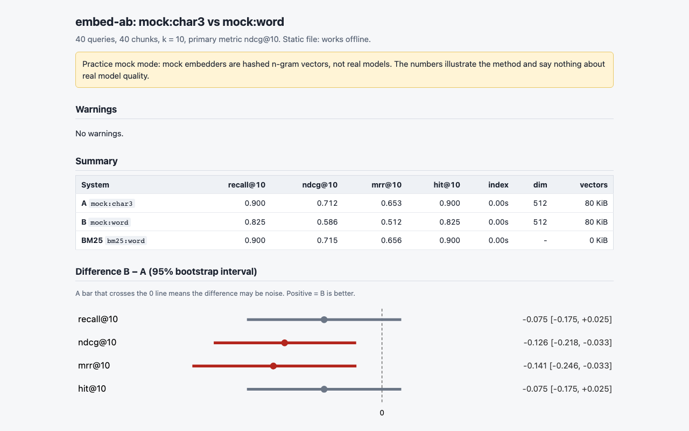
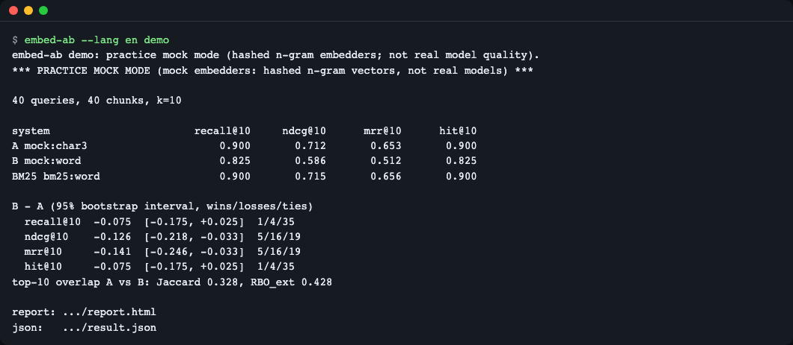
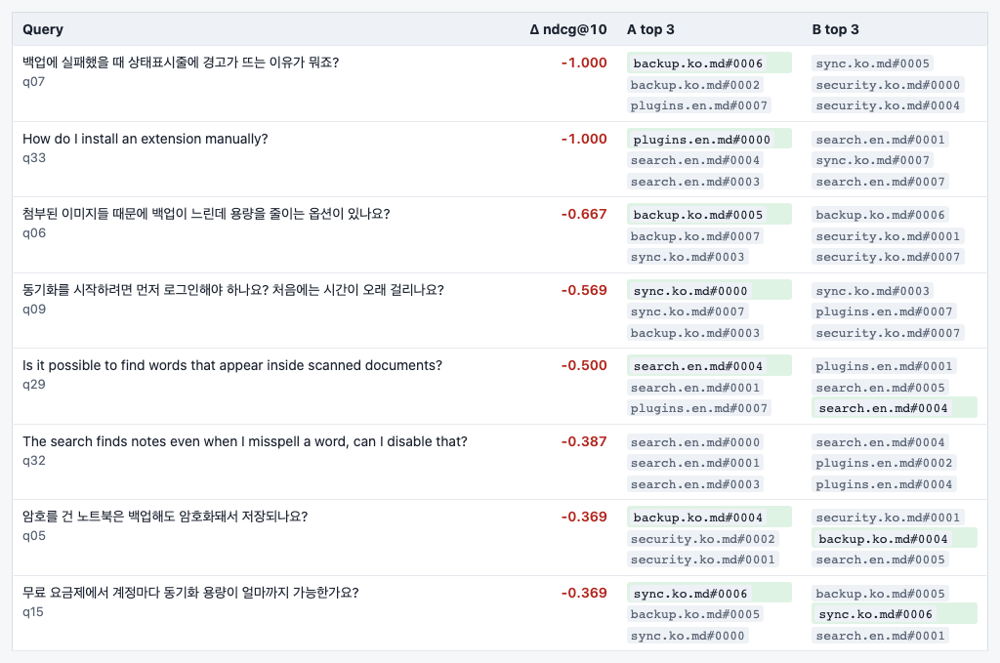
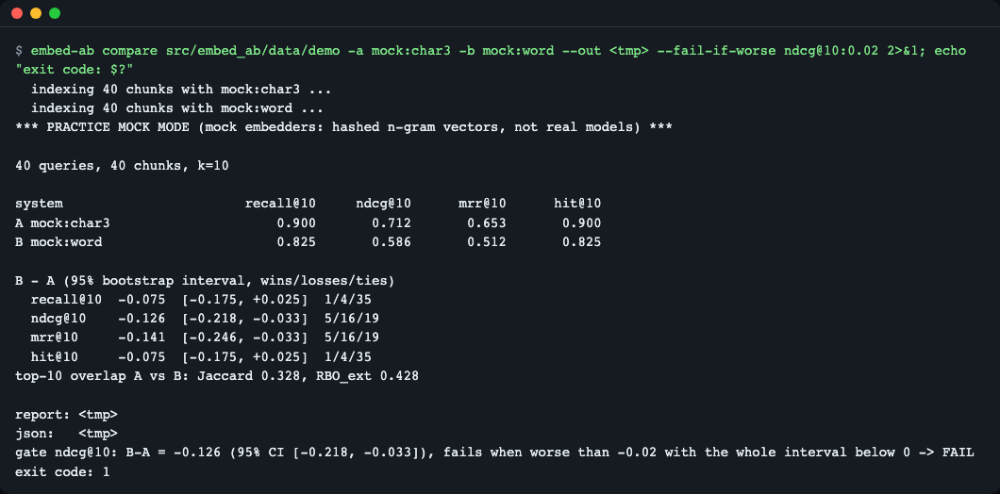
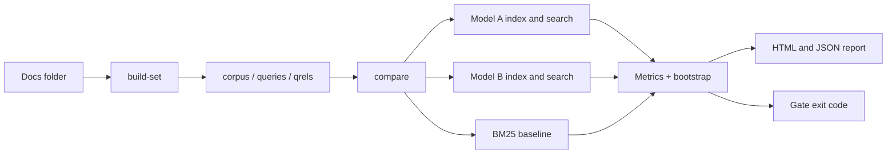

# embed-ab

[한국어](README.md) | **English**

`embed-ab` A/B-tests two embedding models (plus a BM25 baseline) on your own documents and reports Recall@k, nDCG@k, MRR@k with bootstrap confidence intervals, per-query wins and losses, and top-k overlap, as one static HTML file. Use it before swapping an embedding model or re-indexing a RAG store, or as a CI gate (`--fail-if-worse`). Try it offline: `uvx --from git+https://github.com/LeeGyeongPil/embed-ab embed-ab demo`.

It is a command-line tool that lets you decide "will search get worse if I change the model?" with **numbers and confidence intervals** computed on your own documents and questions, instead of eyeballing a few sample questions.


*The top of the report made by `embed-ab demo`. You can see the title, the practice mock mode notice and the summary table.*

## Who it is for
- People wondering whether to switch the model they use now because a new embedding model (multilingual, Korean-specialized, a local Ollama model) has come out
- People who want to see in numbers "is it worth switching?" before spending time and money on a full re-index
- People who want CI to block a PR that changes chunk settings or the model version if it lowers search quality

## Installation
The only prerequisite is [uv](https://docs.astral.sh/uv/) (uv fetches Python 3.12 or later by itself).
```bash
curl -LsSf https://astral.sh/uv/install.sh | sh        # Install uv
uv tool install git+https://github.com/LeeGyeongPil/embed-ab   # Install embed-ab
embed-ab --version
```
To run it just once without installing, use `uvx --from git+https://github.com/LeeGyeongPil/embed-ab embed-ab demo`.
To use it with real documents and models, add the optional dependencies: for Hugging Face models, `uv tool install "embed-ab[st] @ git+https://github.com/LeeGyeongPil/embed-ab"`; for Ollama and OpenAI-compatible servers no extra installation is needed.

If you download the repository and use it as a development environment (all the example commands below were run and checked this way; if you installed it, drop `uv run`):
```bash
git clone https://github.com/LeeGyeongPil/embed-ab && cd embed-ab
uv sync
uv run embed-ab --version      # embed-ab 0.1.1
```

## Quick start
A demo in **practice (mock) mode** that needs neither keys nor network.
```bash
uv run embed-ab demo
```
```text
embed-ab demo: practice mock mode (hashed n-gram embedders; not real model quality).
*** PRACTICE MOCK MODE (mock embedders: hashed n-gram vectors, not real models) ***

40 queries, 40 chunks, k=10

system                       recall@10     ndcg@10      mrr@10      hit@10
A mock:char3                     0.900       0.712       0.653       0.900
B mock:word                      0.825       0.586       0.512       0.825
BM25 bm25:word                   0.900       0.715       0.656       0.900

B - A (95% bootstrap interval, wins/losses/ties)
  recall@10  -0.075  [-0.175, +0.025]  1/4/35
  ndcg@10    -0.126  [-0.218, -0.033]  5/16/19
  mrr@10     -0.141  [-0.246, -0.033]  5/16/19
  hit@10     -0.075  [-0.175, +0.025]  1/4/35
top-10 overlap A vs B: Jaccard 0.328, RBO_ext 0.428

report: .../report.html
json:   .../result.json
```

*The demo run in a terminal. Progress lines ("indexing ...") may appear below the table, and are omitted from the output block above.*

How to read it:
- **What is practice mock mode?** A (`mock:char3`) and B (`mock:word`) are fake embedders that vectorize character 3-grams and words by hashing. They have nothing to do with the quality of real models and are **for learning the method**. Real modes (`st:`, `ollama:`, `openai:`) download a model or call a server, so they are slower.
- Each row of the table is one system, and larger numbers are better. The `[a, b]` under `B - A` is the **95% confidence interval**: if the interval does not include 0, the difference is likely not by chance. In the result above, ndcg@10 is −0.126 with the whole interval below 0, so "B is clearly worse"; recall@10's interval includes 0, so "we don't know yet". Different metrics can give different conclusions.
- `1/4/35` is the number of queries B won / lost / tied.
- `Jaccard` and `RBO_ext` show how much the top 10 picked by the two models overlap (0 to 1). If the overlap is low, even when the metrics are similar, the results users see after re-indexing will differ.

## Usage
| Command | What it does |
|---|---|
| `embed-ab demo` | Offline practice with the built-in evaluation set. `--export DIR` extracts the documents and the evaluation set |
| `embed-ab build-set <docs-folder>` | Builds `corpus.jsonl`, `queries.jsonl` and `qrels.tsv` from `.md/.txt/.jsonl` documents (questions are synthesized by mock or Ollama) |
| `embed-ab compare <eval-set> -a A -b B` | Compares two models, generates the HTML and JSON reports, and decides the gate |

A model is specified as `provider:name`.

| Provider | Example | Notes |
|---|---|---|
| `mock:` | `mock:char3`, `mock:word` | Practice. No keys or network needed |
| `st:` | `st:sentence-transformers/all-MiniLM-L6-v2` | Needs `embed-ab[st]` installed; the model downloads on first run |
| `ollama:` | `ollama:bge-m3` | Local Ollama server (`OLLAMA_HOST`) |
| `openai:` | `openai:text-embedding-3-small` | OpenAI-compatible API (`OPENAI_BASE_URL`, `OPENAI_API_KEY`) |

Main options of `compare`: `--bm25 [word|char2]` (adds a BM25 baseline; `char2` is recommended for Korean), `-k` (default 10), `--max-queries N`, `--seed`, `--bootstrap`, `--report`/`--json`/`--out` (save locations), `--no-cache`, `--a-query-prompt --a-doc-prompt --b-query-prompt --b-doc-prompt` (for models like E5 and BGE that need a prefix on queries and documents), `--fail-if-worse METRIC@K:DELTA`.

### Scenario 1 — Run `compare` yourself with the built-in evaluation set
```bash
uv run embed-ab demo --export ./my-set
uv run embed-ab compare ./my-set -a mock:char3 -b mock:word --bm25
```
`./my-set` will contain `corpus.jsonl` (40 chunks), `queries.jsonl` (40 questions), `qrels.tsv` (query id, correct chunk id, score) and the original `docs/`. The output is the same table as the demo above, and the last line shows the HTML location after `report:`. The per-query comparison is viewed in the report.


*The "most worsened queries" table. For each query, the top 3 results of A and B are shown, with the correct answer highlighted. You can see rows where the word-level model misses the correct answer on Korean questions with attached particles.*

### Scenario 2 — Build an evaluation set from your own documents
```bash
uv run embed-ab build-set ./my-set/docs --chunk-chars 200 --llm mock --out ./mine
```
```text
Wrote 27 chunks, 27 queries to mine
WARNING 27/27 questions reuse >= 60% of their chunk's words (lexical-overlap bias favours BM25). Use --max-copy to filter, or add real questions.
NOTE: --llm mock copies chunk wording on purpose (practice mode). Use --llm ollama:<model> for real questions.
```
The practice `--llm mock` uses the first sentence of a chunk as the question as it is. So if you run `compare` on this set, every system scores 1.000, and the `ceiling`, `copied_queries`, `few_queries` and `not_significant` warnings all appear. This means that **copied questions are answered correctly by any model, so they have no evaluation value**. In practice, synthesize questions with `--llm ollama:<model>`, or fill in `queries.jsonl` and `qrels.tsv` yourself with real user questions. The default chunk size is 600 characters.

### Evaluation set format (BEIR)
An evaluation set is three files in one folder, in the same format as [BEIR](https://github.com/beir-cellar/beir). The examples below are the beginning of the built-in set exactly as extracted with `embed-ab demo --export`.

`corpus.jsonl` — the chunks to search. One JSON per line; `_id` (a unique chunk id) and `text` are required, `title` is optional.
```json
{"_id": "backup.ko.md#0000", "text": "자동 백업은 매일 새벽 3시에 실행되며 최근 7일치 사본을 보관합니다. ..."}
{"_id": "backup.ko.md#0001", "text": "수동 백업을 만들려면 파일 메뉴에서 '지금 백업'을 누르세요. ..."}
```
(The chunk texts are Korean sample data: "Automatic backup runs every day at 3 a.m. and keeps copies of the last 7 days." and "To create a manual backup, press 'Back up now' in the File menu.")

`queries.jsonl` — the questions. Same shape (`_id`, `text`).
```json
{"_id": "q01", "text": "자동으로 백업해 주는 사본은 보관기간이 어떻게 되나요?"}
{"_id": "q02", "text": "수동으로 백업본을 만드는 메뉴가 어디에 있나요?"}
```
(Sample questions: "How long are the automatically made backup copies kept?" and "Where is the menu for creating a backup manually?")

`qrels.tsv` — the correct chunks per question. Three **tab**-separated columns (`query-id`, `corpus-id`, `score`). The header on the first line may be present or absent.
```text
query-id	corpus-id	score
q01	backup.ko.md#0000	1
q02	backup.ko.md#0001	1
```
Rules:
- `score` is an integer grade, and 1 or more means a correct answer (0 is not correct). A question may have several correct answers; in that case write several rows.
- Every question must have at least one row with `score` of 1 or more. Otherwise it is an error (exit code 2).
- To mix in real questions, add a line `{"_id": "r01", "text": "<real user question>"}` to `queries.jsonl`, add a line `r01<tab><correct chunk id><tab>1` to `qrels.tsv`, and run the same `compare` command again. With 30 or more questions, the `few_queries` warning goes away.

### Scenario 3 — Comparing real models
Make the evaluation set folder (`./my-set`) with `embed-ab demo --export ./my-set` from scenario 1, or swap in a folder you built yourself like `./mine` from scenario 2.
```bash
uv run embed-ab compare ./my-set -a st:sentence-transformers/all-MiniLM-L6-v2 -b ollama:bge-m3 --bm25 char2 --out ./report
```
(This needs models and a server, so this document does not include the output. When checked during development with bge-m3 on a local Ollama, on the 40-question set above bge-m3's ndcg@10 was 0.954 and mock:char3's was 0.712, a difference of +0.242 [+0.156, +0.332].)

### Scenario 4 — CI gate
```bash
uv run embed-ab compare ./my-set -a mock:char3 -b mock:word --fail-if-worse ndcg@10:0.02
echo "exit code: $?"
```
The last line is as follows, and the exit code is 1.
```text
gate ndcg@10: B-A = -0.126 (95% CI [-0.218, -0.033]), fails when worse than -0.02 with the whole interval below 0 -> FAIL
```

*B is worse by more than 0.02 and the whole interval is below 0, so FAIL, exit code 1.*

If you swap A and B, you get `B-A = +0.126 (95% CI [+0.033, +0.218]) ... -> PASS`, exit code 0. Exit codes: 0 pass, 1 gate failure, 2 input error (nonexistent folder, `bogus@10`, `ndcg@5` that differs from `-k`, etc.). The gate's k must equal `-k`.

#### Wiring it into GitHub Actions
A workflow example that blocks search-quality regressions on PRs that change the model or chunk settings. It assumes you have committed the evaluation set (the three files in an `eval/` folder) to the repository. This YAML is an example whose syntax alone was checked; this repository's own CI runs only the demo with mock models.
```yaml
name: retrieval-gate
on: pull_request
jobs:
  gate:
    runs-on: ubuntu-latest
    steps:
      - uses: actions/checkout@v4
      - uses: astral-sh/setup-uv@v6
      - uses: actions/cache@v4            # st: 모델을 쓸 때만: 모델 다운로드를 재사용
        with:
          path: ~/.cache/huggingface
          key: hf-${{ hashFiles('eval/**') }}
      - run: >
          uvx --from "embed-ab[st] @ git+https://github.com/LeeGyeongPil/embed-ab"
          embed-ab compare eval/
          -a st:sentence-transformers/all-MiniLM-L6-v2
          -b st:BAAI/bge-small-en-v1.5
          --fail-if-worse ndcg@10:0.02
```
(The comment on the cache step reads: "only when using st: models: reuse the model download".)
- `astral-sh/setup-uv` installs uv, and `uvx` installs `embed-ab` into a temporary environment and runs it. If you have no `st:` models, you can drop `[st]`.
- If B is worse at the gate, this step fails with exit code 1 and the PR is blocked.
- `actions/cache` stores the Hugging Face model cache (`~/.cache/huggingface`) so it is not downloaded again every time. The runner has no server for `ollama:` models, so in CI use `st:` or `openai:`.

### Scenario 5 — The warning when there are few questions
```bash
uv run embed-ab compare ./my-set -a mock:char3 -b mock:word --max-queries 6
```
`WARNING [few_queries] Only 6 queries (< 30): ...` appears, and the ndcg@10 difference becomes −0.223 [−0.425, −0.039], with a wider interval. Compare that with [−0.218, −0.033] at 40 questions. With few questions, even the same conclusion is far more uncertain.

## Configuration
| Name | Purpose |
|---|---|
| `EMBED_AB_CACHE_DIR` | Embedding cache location (default `$XDG_CACHE_HOME/embed-ab`, otherwise `~/.cache/embed-ab`) |
| `OLLAMA_HOST` | Ollama server address (default `http://localhost:11434`) |
| `OPENAI_BASE_URL`, `OPENAI_API_KEY` | For the `openai:` provider. A local compatible server often does not need a key |
| `SSL_CERT_FILE`, `HF_HUB_DISABLE_XET`, `HF_HUB_OFFLINE` | For fixing Hugging Face download problems (see below) |

The full list is in `.env.example`. The demo and the mock, st and ollama providers need no keys. Reports, results and the cache are by default written only to the cache folder, and appear in the current folder only when you specify it with `--out` or similar. The same models and documents are reused from the cache, so the second run is faster.

All generated files pile up under the cache folder. `embeddings/` is the embedding cache, and in `reports/` a new folder like `mock_char3__vs__mock_word-<time>/` is created every time you run `compare` or `demo`. They are safe to delete (they are recreated on the next run), and you can clear everything at once with the following.
```bash
rm -rf ~/.cache/embed-ab        # EMBED_AB_CACHE_DIR 을 썼다면 그 폴더
```
(The comment says: "or that folder if you used EMBED_AB_CACHE_DIR".)

### How to read the report
`report.html` has the following order from top to bottom.
1. **Warnings** — warnings to look at before trusting the result (`few_queries`, `ceiling`, etc.).
2. **Summary** — the per-system metrics table (A, B, BM25).
3. **Difference B − A** — the difference per metric and its 95% confidence interval. Only when the interval excludes 0 is it "a real difference".
4. **Per-query wins and losses** — the cases where B won or lost per query. It shows the top results for the most worsened and most improved queries.
5. **Top-k overlap** — how much the top-k lists of the two models overlap (Jaccard, RBO_ext). Even if the metrics are similar, if the overlap is low, the results users see after re-indexing will differ.
6. **Reproduction** — the information needed to get the same result again, such as model names and versions, the seed and the number of bootstrap rounds.

#### What the warnings mean
`few_queries` (fewer than 30 questions), `ceiling` (everything scores perfectly), `copied_queries` (questions copy the chunk) and `not_significant` (the confidence interval includes 0), which appear in `Warnings`, are signals saying "do not draw a conclusion from these numbers alone". Even with warnings the run succeeds (exit code 0), and the cause and fix for each are in the [Common problems](#common-problems) table below.

## How it works

- `build-set`: splits documents into chunks, makes questions for each chunk, and records the correct pairs (qrels).
- `compare`: indexes the same chunks and the same questions with model A, model B and BM25 separately and finds the top k per question.
- Metrics: computes whether the correct answer is within the top k (Recall, Hit) and how high it ranks (MRR, nDCG).
- Bootstrap: resamples the questions with replacement many times to get the 95% interval of the `B - A` difference (a paired comparison per question).
- Overlap: measures how much the top-k lists of the two models agree with Jaccard and RBO_ext, showing the felt change of re-indexing.
- The report is a single HTML file with no external addresses, and the gate is an exit code read by CI, not by a person.

## Comparison with other tools
| | embed-ab | MTEB / public leaderboards | BEIR / hand-written scripts |
|---|---|---|---|
| Evaluation data | Your documents, your questions | Public benchmarks | Public benchmarks or your own |
| Confidence intervals, per-query wins and losses | Built in | Mostly average scores | Implement yourself |
| Top-k overlap, BM25 baseline | Built in | None | Implement yourself |
| CI exit code | Yes | None | Implement yourself |
| Number of models covered | Compares two at a time | Compares hundreds | Free |

Public leaderboards are better as a starting point for picking candidate models. embed-ab takes the step of **checking on your data** the two or three you narrowed down that way. It is exact brute-force vector search (inner product), so it targets scales up to tens of thousands of chunks, and it does not cover vector-DB performance comparison.

## Common problems
| Symptom | Cause | Fix |
|---|---|---|
| `st:` model download fails with an SSL error or hangs | The certificate path cannot be found, or Hugging Face's xet download is blocked in this environment | `SSL_CERT_FILE=/etc/ssl/cert.pem HF_HUB_DISABLE_XET=1 uv run embed-ab compare ...` (macOS path; on Linux, your distribution's CA bundle path) |
| `error: Evaluation set folder not found` | A typo in the evaluation-set folder path (exit code 2) | Specify the folder containing `corpus.jsonl`, `queries.jsonl` and `qrels.tsv` |
| `error: Metric 'ndcg@5' does not match -k 10` | The gate's k differs from `-k` | Pass `-k 5` as well, or gate on `ndcg@10` |
| `WARNING [few_queries]` | Fewer than 30 questions | Add more questions. Mix in hard questions too |
| `WARNING [ceiling]` | All models score nearly perfect, so they cannot be told apart | Add harder questions (questions with changed wording) |
| `WARNING [copied_queries]` | Questions copy chunk sentences as they are, which favors BM25 and word models | Use real user questions, or rebuild the evaluation set with `build-set ... --max-copy 0.6` (`--max-copy` is an option of `build-set`, not `compare`, and discards questions whose overlap ratio is this value or more (>=)). In practice mock mode, questions copy the chunk, so at 0.6 all of them are discarded and it may produce an error |
| `error: No questions were produced (all 7 were at or above --max-copy 0.6)` | Questions made in practice mock mode copy chunk sentences, so all are discarded at `--max-copy 0.6` (exit code 2) | Use a real question generator (`--llm ollama:<model>`), or raise `--max-copy` (for example 0.7). In mock mode, raising the value removes the error but the copied_queries warning may come back (normal for practice; a set without the warning is made with a real question generator) |
| `WARNING [not_significant]` | The confidence interval of the difference includes 0 | Add more questions, or interpret it as "no difference" |
| Ollama connection error | The server is off or the model is not installed | `ollama serve`, `ollama pull bge-m3`, and set `OLLAMA_HOST` if needed |

## Development and contributing
```bash
uv sync
uv run pytest
```
If `77 passed` appears on the last line, all is well (the configuration already has `-q`, so adding `-q` again makes the summary line disappear). All 77 tests pass (Python 3.12 and 3.13, run with the network blocked). Please leave bugs and suggestions as issues. The change log is [CHANGELOG.md](CHANGELOG.md).

Code map (`src/embed_ab/`):

| File | What it does |
|---|---|
| `cli.py` | The commands (`demo`, `build-set`, `compare`), options and exit codes |
| `compare.py` | Runs A, B and BM25 search and bundles the metrics, differences and gate decision |
| `metrics.py` | Recall, Hit, MRR and nDCG calculation |
| `stats.py` | Per-query paired bootstrap confidence intervals |
| `overlap.py` | Top-k overlap (Jaccard, RBO_ext) |
| `providers.py` | The `mock:`, `st:`, `ollama:` and `openai:` embedding providers |
| `report.py` | The single HTML report |
| `evalset.py` | Reading and validating BEIR-format evaluation sets |

## Glossary
- **Embedding**: text turned into a numeric vector. Texts with similar meaning have close vectors.
- **Recall@k / Hit@k**: the fraction of queries whose correct answer is within the top k.
- **MRR@k**: the average of the reciprocal rank of the first correct answer. 1 if the answer is first, 0.5 if second.
- **nDCG@k**: a ranking metric that gives more score the higher the correct answers are (0 to 1).
- **BM25**: traditional word-frequency-based search. A baseline that embeddings must beat to be meaningful.
- **Bootstrap confidence interval**: the "range of wobble of the difference" obtained by resampling the questions and computing the metric many times.
- **Jaccard / RBO_ext**: the degree of overlap of two ranked lists. RBO puts more weight on the upper ranks.
- **qrels**: a table listing the correct chunks per question.

## Try changing things yourself
1. **Change k** — What to change: `-k 3`. Expected: only the top 3 are looked at, so recall drops and the difference grows. Check: in `uv run embed-ab compare ./my-set -a mock:char3 -b mock:word -k 3`, recall@3 is −0.200 [−0.325, −0.075], a bigger difference than recall@10's −0.075.
2. **Swap A and B** — What to change: `-a mock:word -b mock:char3` and `--fail-if-worse ndcg@10:0.02`. Expected: the sign flips and the gate passes. Check: `PASS` and exit code 0.
3. **Change the BM25 tokenizer** — What to change: `--bm25 char2`. Expected: on Korean with attached particles, the BM25 score rises compared with word-level (on the built-in set, bm25:word 0.715 → bm25:char2 0.820. BM25 is a baseline independent of the embedding models). Check: compare the `bm25:char2` row of the table with the `--bm25 word` result.

## Learn more
- Articles saying public leaderboard rankings can flip on your own data: https://jxnl.co/writing/2025/09/11/stop-trusting-mteb-rankings-kelly-hong-chroma/ , https://trychroma.com/research/generative-benchmarking (checked 2026-11-10)
- Guidance to evaluate first on a sample of your own data before swapping models: https://www.mongodb.com/docs/voyageai/tutorials/migrate-embedding-model/ (checked 2026-11-10)

## License
MIT. The built-in demo documents and evaluation set are text written directly for this repository and are under the same license. For models used through `st:`, `ollama:` and `openai:`, follow each model's license.
