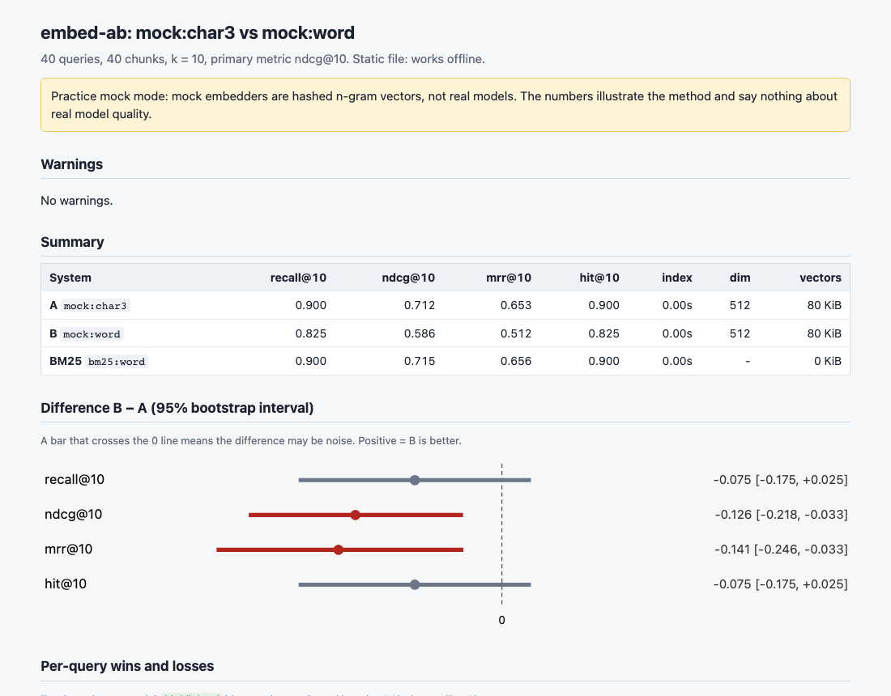
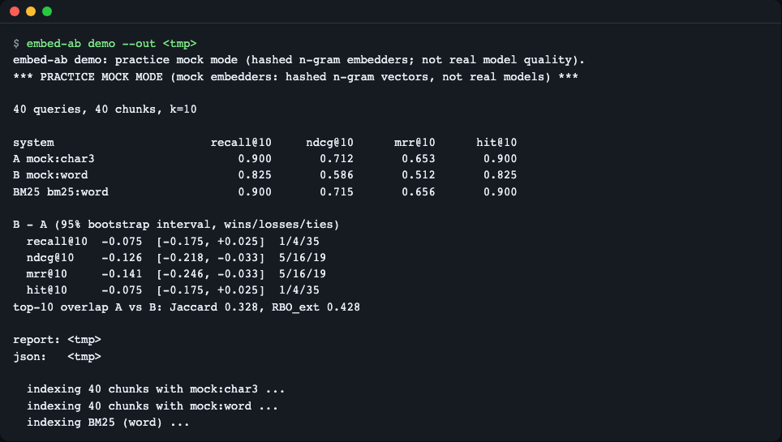
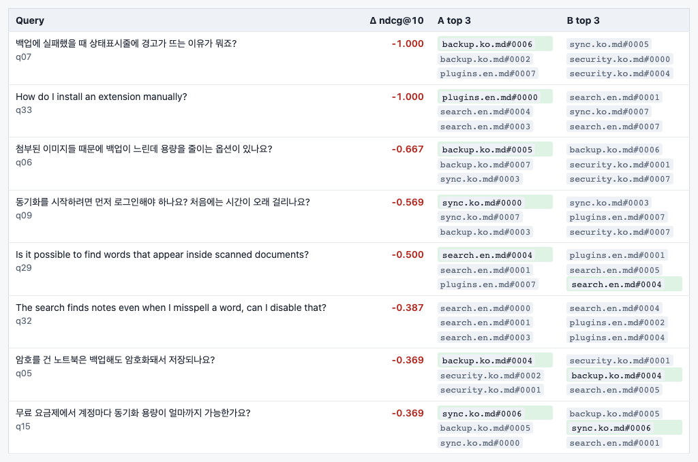
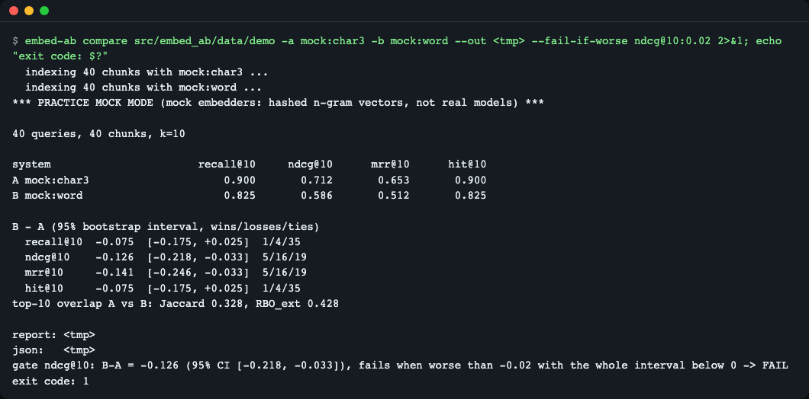
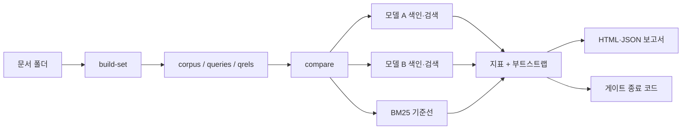

# embed-ab

> **English summary** — `embed-ab` A/B-tests two embedding models (plus a BM25 baseline) on your own documents and reports Recall@k, nDCG@k, MRR@k with bootstrap confidence intervals, per-query wins and losses, and top-k overlap, as one static HTML file. Use it before swapping an embedding model or re-indexing a RAG store, or as a CI gate (`--fail-if-worse`). Try it offline: `uvx --from git+https://github.com/LeeGyeongPil/embed-ab embed-ab demo`.

"모델을 바꿔도 검색이 나빠지지 않을까?"를 표본 질문 몇 개를 눈으로 비교하는 대신, 내 문서와 질문으로 **수치와 신뢰구간**을 뽑아 결정하게 해 주는 명령줄 도구입니다.


*`embed-ab demo` 가 만든 보고서 맨 위. 제목, 연습용 mock 모드 고지, 요약 표가 보입니다.*

## 이런 분께
- 새 임베딩 모델(다국어, 한국어 특화, 로컬 Ollama 모델)이 나와서 지금 쓰는 모델을 바꿀지 고민하는 분
- 전체 재색인에 시간·비용을 쓰기 전에 "바꿀 가치가 있는지" 수치로 보고 싶은 분
- 청크 설정이나 모델 버전을 바꾸는 PR 이 검색 품질을 떨어뜨리지 않는지 CI 에서 막고 싶은 분

## 설치
전제 도구는 [uv](https://docs.astral.sh/uv/) 하나입니다(Python 3.12 이상은 uv 가 알아서 받습니다).
```bash
curl -LsSf https://astral.sh/uv/install.sh | sh        # uv 설치
uv tool install git+https://github.com/LeeGyeongPil/embed-ab   # embed-ab 설치
embed-ab --version
```
설치 없이 한 번만 돌려 보려면 `uvx --from git+https://github.com/LeeGyeongPil/embed-ab embed-ab demo` 를 쓰세요.
실제 문서와 모델로 쓰려면 선택 의존성을 더합니다: Hugging Face 모델은 `uv tool install "embed-ab[st] @ git+https://github.com/LeeGyeongPil/embed-ab"`, Ollama·OpenAI 호환 서버는 추가 설치가 필요 없습니다.

저장소를 내려받아 개발 환경으로 쓰는 경우(아래 예시 명령은 모두 이 방식으로 실행해 확인했습니다. 설치했다면 `uv run` 을 빼세요):
```bash
git clone https://github.com/LeeGyeongPil/embed-ab && cd embed-ab
uv sync
uv run embed-ab --version      # embed-ab 0.1.0
```

## 빠르게 시작하기
키도 네트워크도 필요 없는 **연습용(mock) 모드** 데모입니다.
```bash
uv run embed-ab demo
```
```text
embed-ab demo: practice mock mode (hashed n-gram embedders; not real model quality).
*** PRACTICE MOCK MODE (mock embedders: hashed n-gram vectors, not real models) ***

40 queries, 40 chunks, k=10

system                       recall@10     ndcg@10      mrr@10      hit@10
A mock:char3                     0.900       0.712       0.653       0.900
B mock:word                      0.825       0.586       0.512       0.825
BM25 bm25:word                   0.900       0.715       0.656       0.900

B - A (95% bootstrap interval, wins/losses/ties)
  recall@10  -0.075  [-0.175, +0.025]  1/4/35
  ndcg@10    -0.126  [-0.218, -0.033]  5/16/19
  mrr@10     -0.141  [-0.246, -0.033]  5/16/19
  hit@10     -0.075  [-0.175, +0.025]  1/4/35
top-10 overlap A vs B: Jaccard 0.328, RBO_ext 0.428

report: .../report.html
json:   .../result.json
```

*터미널에서 데모를 실행한 화면. 진행 줄("indexing ...")은 표 아래에 보일 수 있으며, 위 출력 블록에서는 생략했습니다.*

읽는 법:
- **연습용 mock 모드란?** A(`mock:char3`)와 B(`mock:word`)는 글자 3-gram, 단어를 해시로 벡터화한 가짜 임베더입니다. 진짜 모델의 품질과는 무관하고 **방법을 익히기 위한 것**입니다. 실제 모드(`st:`, `ollama:`, `openai:`)는 모델을 내려받거나 서버를 호출하므로 더 느립니다.
- 표의 한 줄이 시스템 하나, 숫자가 클수록 좋습니다. `B - A` 아래 `[a, b]` 는 **95% 신뢰구간**: 구간이 0 을 포함하지 않으면 차이가 우연이 아닐 가능성이 큽니다. 위 결과에서 ndcg@10 은 −0.126 으로 구간 전체가 0 아래라 "B 가 확실히 나쁘다", recall@10 은 구간이 0 을 포함해 "아직 모른다"입니다. 지표마다 결론이 다를 수 있습니다.
- `1/4/35` 는 질문별로 B 가 이긴 수/진 수/비긴 수입니다.
- `Jaccard`, `RBO_ext` 는 두 모델이 뽑은 상위 10개가 얼마나 겹치는지(0~1)입니다. 겹침이 낮으면 지표가 비슷해도 재색인 후 사용자가 보는 결과가 달라집니다.

## 사용법
| 명령 | 하는 일 |
|---|---|
| `embed-ab demo` | 내장 평가 세트로 오프라인 연습. `--export DIR` 은 문서·평가 세트를 꺼내 줌 |
| `embed-ab build-set <문서폴더>` | `.md/.txt/.jsonl` 문서로 `corpus.jsonl`·`queries.jsonl`·`qrels.tsv` 를 만듦(질문은 mock 또는 Ollama 가 합성) |
| `embed-ab compare <평가세트> -a A -b B` | 두 모델 비교, HTML·JSON 보고서 생성, 게이트 판정 |

모델은 `제공자:이름` 으로 지정합니다.

| 제공자 | 예 | 비고 |
|---|---|---|
| `mock:` | `mock:char3`, `mock:word` | 연습용. 키·네트워크 불필요 |
| `st:` | `st:sentence-transformers/all-MiniLM-L6-v2` | `embed-ab[st]` 설치 필요, 첫 실행에 모델 다운로드 |
| `ollama:` | `ollama:bge-m3` | 로컬 Ollama 서버(`OLLAMA_HOST`) |
| `openai:` | `openai:text-embedding-3-small` | OpenAI 호환 API(`OPENAI_BASE_URL`, `OPENAI_API_KEY`) |

`compare` 의 주요 옵션: `--bm25 [word|char2]`(BM25 기준선 추가, 한국어는 `char2` 권장), `-k`(기본 10), `--max-queries N`, `--seed`, `--bootstrap`, `--report`/`--json`/`--out`(저장 위치), `--no-cache`, `--a-query-prompt --a-doc-prompt --b-query-prompt --b-doc-prompt`(E5·BGE 처럼 질문·문서에 접두어가 필요한 모델), `--fail-if-worse METRIC@K:DELTA`.

### 시나리오 1 — 내장 평가 세트로 `compare` 를 직접 돌려 보기
```bash
uv run embed-ab demo --export ./my-set
uv run embed-ab compare ./my-set -a mock:char3 -b mock:word --bm25
```
`./my-set` 에는 `corpus.jsonl`(청크 40개), `queries.jsonl`(질문 40개), `qrels.tsv`(질문 id, 정답 청크 id, 점수)와 원본 `docs/` 가 생깁니다. 출력은 위 데모와 같은 표이고, 마지막 줄에 `report:` 로 HTML 위치가 나옵니다. 질문별 비교는 보고서에서 봅니다.


*"가장 나빠진 질문" 표. 질문마다 A·B 의 상위 3개 결과가 나오고, 정답은 강조됩니다. 조사가 붙은 한국어 질문에서 단어 단위 모델이 정답을 놓치는 행이 보입니다.*

### 시나리오 2 — 내 문서로 평가 세트 만들기
```bash
uv run embed-ab build-set ./my-set/docs --chunk-chars 200 --llm mock --out ./mine
```
```text
Wrote 27 chunks, 27 queries to mine
WARNING 27/27 questions reuse >= 60% of their chunk's words (lexical-overlap bias favours BM25). Use --max-copy to filter, or add real questions.
NOTE: --llm mock copies chunk wording on purpose (practice mode). Use --llm ollama:<model> for real questions.
```
연습용 `--llm mock` 은 청크 첫 문장을 그대로 질문으로 씁니다. 그래서 이 세트로 `compare` 하면 모든 시스템이 1.000 점이고 `ceiling`·`copied_queries`·`few_queries`·`not_significant` 경고가 모두 뜹니다. **복사한 질문은 어떤 모델이든 맞히므로 평가 가치가 없다**는 뜻입니다. 실제로는 `--llm ollama:<모델>` 로 질문을 합성하거나, 실제 사용자 질문으로 `queries.jsonl`·`qrels.tsv` 를 직접 채우세요. 기본 청크 크기는 600자입니다.

### 평가 세트 형식 (BEIR)
평가 세트는 폴더 하나에 든 파일 세 개이고, [BEIR](https://github.com/beir-cellar/beir) 와 같은 형식입니다. 아래 예시는 `embed-ab demo --export` 로 꺼낸 내장 세트의 앞부분 그대로입니다.

`corpus.jsonl` — 검색 대상 청크. 한 줄에 JSON 하나, `_id`(청크 고유 id)와 `text` 가 필수, `title` 은 선택입니다.
```json
{"_id": "backup.ko.md#0000", "text": "자동 백업은 매일 새벽 3시에 실행되며 최근 7일치 사본을 보관합니다. ..."}
{"_id": "backup.ko.md#0001", "text": "수동 백업을 만들려면 파일 메뉴에서 '지금 백업'을 누르세요. ..."}
```
`queries.jsonl` — 질문. 같은 모양(`_id`, `text`)입니다.
```json
{"_id": "q01", "text": "자동으로 백업해 주는 사본은 보관기간이 어떻게 되나요?"}
{"_id": "q02", "text": "수동으로 백업본을 만드는 메뉴가 어디에 있나요?"}
```
`qrels.tsv` — 질문별 정답 청크. **탭**으로 구분한 3열(`query-id`, `corpus-id`, `score`)입니다. 첫 줄의 헤더는 있어도 없어도 됩니다.
```text
query-id	corpus-id	score
q01	backup.ko.md#0000	1
q02	backup.ko.md#0001	1
```
규칙:
- `score` 는 정수 등급이고 1 이상이 정답입니다(0 은 정답 아님). 한 질문에 정답이 여러 개여도 됩니다. 그럴 때는 행을 여러 줄 씁니다.
- 모든 질문에는 `score` 1 이상인 행이 하나 이상 있어야 합니다. 없으면 오류(종료 코드 2)입니다.
- 실제 질문을 섞으려면 `queries.jsonl` 에 `{"_id": "r01", "text": "<실제 사용자 질문>"}` 줄을 더하고, `qrels.tsv` 에 `r01<탭><정답 청크 id><탭>1` 줄을 더한 뒤 같은 `compare` 명령을 다시 돌리면 됩니다. 질문이 30개 이상이면 `few_queries` 경고가 사라집니다.

### 시나리오 3 — 실제 모델 비교
평가 세트 폴더(`./my-set`)는 시나리오 1 의 `embed-ab demo --export ./my-set` 으로 만들거나 시나리오 2 의 `./mine` 처럼 직접 만든 폴더로 바꿔 씁니다.
```bash
uv run embed-ab compare ./my-set -a st:sentence-transformers/all-MiniLM-L6-v2 -b ollama:bge-m3 --bm25 char2 --out ./report
```
(모델·서버가 있어야 하므로 이 문서에서는 출력을 싣지 않습니다. 개발 중 로컬 Ollama 의 bge-m3 로 확인했을 때, 위 40질문 세트에서 bge-m3 의 ndcg@10 은 0.954, mock:char3 는 0.712, 차이 +0.242 [+0.156, +0.332] 였습니다.)

### 시나리오 4 — CI 게이트
```bash
uv run embed-ab compare ./my-set -a mock:char3 -b mock:word --fail-if-worse ndcg@10:0.02
echo "exit code: $?"
```
마지막 줄은 다음과 같고 종료 코드는 1 입니다.
```text
gate ndcg@10: B-A = -0.126 (95% CI [-0.218, -0.033]), fails when worse than -0.02 with the whole interval below 0 -> FAIL
```

*B 가 0.02 넘게 나쁘고 구간 전체가 0 아래라서 FAIL, 종료 코드 1.*

A·B 를 맞바꾸면 `B-A = +0.126 (95% CI [+0.033, +0.218]) ... -> PASS`, 종료 코드 0 입니다. 종료 코드: 0 통과, 1 게이트 실패, 2 입력 오류(없는 폴더, `bogus@10`, `-k` 와 다른 `ndcg@5` 등). 게이트의 k 는 `-k` 와 같아야 합니다.

#### GitHub Actions 에 붙이기
모델·청크 설정을 바꾸는 PR 에서 검색 품질 회귀를 막는 워크플로 예시입니다. 평가 세트(`eval/` 폴더의 세 파일)를 레포에 커밋해 두는 것을 전제로 합니다. 이 YAML 은 문법만 확인한 예시이고, 이 레포의 CI 는 mock 모델로 데모만 돌립니다.
```yaml
name: retrieval-gate
on: pull_request
jobs:
  gate:
    runs-on: ubuntu-latest
    steps:
      - uses: actions/checkout@v4
      - uses: astral-sh/setup-uv@v6
      - uses: actions/cache@v4            # st: 모델을 쓸 때만: 모델 다운로드를 재사용
        with:
          path: ~/.cache/huggingface
          key: hf-${{ hashFiles('eval/**') }}
      - run: >
          uvx --from "embed-ab[st] @ git+https://github.com/LeeGyeongPil/embed-ab"
          embed-ab compare eval/
          -a st:sentence-transformers/all-MiniLM-L6-v2
          -b st:BAAI/bge-small-en-v1.5
          --fail-if-worse ndcg@10:0.02
```
- `astral-sh/setup-uv` 가 uv 를 설치하고, `uvx` 가 `embed-ab` 를 임시 환경에 설치해 실행합니다. `st:` 모델이 없다면 `[st]` 를 빼도 됩니다.
- 게이트에서 B 가 나쁘면 종료 코드 1 로 이 단계가 실패하고 PR 이 막힙니다.
- `actions/cache` 는 Hugging Face 모델 캐시(`~/.cache/huggingface`)를 저장해 매번 다시 내려받지 않게 합니다. `ollama:` 모델은 러너에 서버가 없으므로 CI 에서는 `st:` 나 `openai:` 를 쓰세요.

### 시나리오 5 — 질문이 적을 때의 경고
```bash
uv run embed-ab compare ./my-set -a mock:char3 -b mock:word --max-queries 6
```
`WARNING [few_queries] Only 6 queries (< 30): ...` 가 뜨고 ndcg@10 차이는 −0.223 [−0.425, −0.039] 로 구간이 넓어집니다. 40개일 때 [−0.218, −0.033] 이었던 것과 비교해 보세요. 질문이 적으면 같은 결론도 훨씬 불확실합니다.

## 설정
| 이름 | 용도 |
|---|---|
| `EMBED_AB_CACHE_DIR` | 임베딩 캐시 위치(기본 `$XDG_CACHE_HOME/embed-ab`, 없으면 `~/.cache/embed-ab`) |
| `OLLAMA_HOST` | Ollama 서버 주소(기본 `http://localhost:11434`) |
| `OPENAI_BASE_URL`, `OPENAI_API_KEY` | `openai:` 제공자용. 로컬 호환 서버는 키가 없어도 되는 경우가 많음 |
| `SSL_CERT_FILE`, `HF_HUB_DISABLE_XET`, `HF_HUB_OFFLINE` | Hugging Face 다운로드 문제 해결용(아래 참고) |

`.env.example` 에 전체 목록이 있습니다. 데모와 mock·st·ollama 제공자는 키가 필요 없습니다. 보고서·결과·캐시는 기본적으로 캐시 폴더에만 쓰이고, 현재 폴더에는 `--out` 등으로 지정할 때만 생깁니다. 같은 모델·문서는 캐시로 재사용되어 두 번째 실행이 빠릅니다.

생성물은 모두 캐시 폴더 아래에 쌓입니다. `embeddings/` 는 임베딩 캐시이고, `reports/` 에는 `compare`·`demo` 를 돌릴 때마다 `mock_char3__vs__mock_word-<시각>/` 같은 새 폴더가 생깁니다. 지워도 안전하고(다음 실행에서 다시 만듭니다) 다음으로 한 번에 비울 수 있습니다.
```bash
rm -rf ~/.cache/embed-ab        # EMBED_AB_CACHE_DIR 을 썼다면 그 폴더
```

### 보고서 읽는 법
`report.html` 은 위에서 아래로 다음 순서입니다.
1. **Warnings** — 결과를 믿기 전에 볼 경고(`few_queries`, `ceiling` 등).
2. **Summary** — 시스템별 지표 표(A, B, BM25).
3. **Difference B − A** — 지표별 차이와 95% 신뢰구간. 구간이 0 을 포함하지 않아야 "차이가 있다"입니다.
4. **Per-query wins and losses** — 질문마다 B 가 이긴·진 사례. 가장 나빠진 질문과 가장 좋아진 질문의 상위 결과를 보여 줍니다.
5. **Top-k overlap** — 두 모델의 상위 k 목록이 얼마나 겹치는지(Jaccard, RBO_ext). 지표가 비슷해도 겹침이 낮으면 재색인 뒤 사용자가 보는 결과는 달라집니다.
6. **Reproduction** — 모델 이름·버전, 시드, 부트스트랩 횟수 등 같은 결과를 다시 얻는 데 필요한 정보.

#### 경고의 뜻
`Warnings` 에 뜨는 `few_queries`(질문 30개 미만), `ceiling`(모두 만점), `copied_queries`(질문이 청크를 베낌), `not_significant`(신뢰구간이 0 포함)는 "이 숫자만으로 결론 내리지 말라"는 신호입니다. 경고가 있어도 실행은 성공(종료 코드 0)하며, 각 원인과 해결은 아래 [자주 겪는 문제](#자주-겪는-문제) 표에 있습니다.

## 동작 원리

- `build-set`: 문서를 청크로 자르고 청크마다 질문을 만들어 정답 쌍(qrels)을 기록합니다.
- `compare`: 같은 청크·같은 질문을 모델 A, 모델 B, BM25 로 각각 색인하고 질문마다 상위 k개를 찾습니다.
- 지표: 정답이 상위 k 안에 있는지(Recall·Hit), 얼마나 위에 있는지(MRR, nDCG)를 계산합니다.
- 부트스트랩: 질문을 복원추출로 여러 번 다시 뽑아 `B - A` 차이의 95% 구간을 구합니다(질문 단위 짝 비교).
- 겹침: 두 모델의 상위 k 목록이 얼마나 같은지 Jaccard 와 RBO_ext 로 재서, 재색인의 체감 변화를 보여 줍니다.
- 보고서는 외부 주소가 없는 단일 HTML 파일이고, 게이트는 사람이 아니라 CI 가 읽는 종료 코드입니다.

## 다른 도구와 비교
| | embed-ab | MTEB / 공개 리더보드 | BEIR·직접 짠 스크립트 |
|---|---|---|---|
| 평가 데이터 | 내 문서·내 질문 | 공개 벤치마크 | 공개 벤치마크 또는 직접 |
| 신뢰구간·질문별 승패 | 기본 제공 | 평균 점수 위주 | 직접 구현 |
| 상위 k 겹침·BM25 기준선 | 기본 제공 | 없음 | 직접 구현 |
| CI 종료 코드 | 있음 | 없음 | 직접 구현 |
| 다루는 모델 수 | 한 번에 둘 비교 | 수백 개 비교 | 자유 |

공개 리더보드는 후보 모델을 고르는 출발점으로 더 낫습니다. embed-ab 은 그렇게 추린 두세 개를 **내 데이터에서 확인하는 단계**를 맡습니다. 정확한 벡터 전수 검색(내적)이라 수만 청크 규모까지가 대상이며, 벡터 DB 성능 비교는 다루지 않습니다.

## 자주 겪는 문제
| 증상 | 원인 | 해결 |
|---|---|---|
| `st:` 모델 다운로드가 SSL 오류·멈춤 | 인증서 경로를 못 찾거나 Hugging Face 의 xet 다운로드가 막힌 환경 | `SSL_CERT_FILE=/etc/ssl/cert.pem HF_HUB_DISABLE_XET=1 uv run embed-ab compare ...` (macOS 기준 경로, 리눅스는 배포판의 CA 번들 경로) |
| `error: Evaluation set folder not found` | 평가 세트 폴더 경로 오타 (종료 코드 2) | `corpus.jsonl`·`queries.jsonl`·`qrels.tsv` 가 든 폴더를 지정 |
| `error: Metric 'ndcg@5' does not match -k 10` | 게이트의 k 와 `-k` 가 다름 | `-k 5` 를 함께 주거나 `ndcg@10` 으로 게이트 |
| `WARNING [few_queries]` | 질문이 30개 미만 | 질문을 늘림. 어려운 질문도 섞음 |
| `WARNING [ceiling]` | 모든 모델이 거의 만점이라 구별 불가 | 더 어려운 질문(표현을 바꾼 질문)을 추가 |
| `WARNING [copied_queries]` | 질문이 청크 문장을 그대로 베껴 BM25·단어 모델에 유리 | 실제 사용자 질문을 쓰거나 `build-set ... --max-copy 0.6` 으로 평가 세트를 다시 만듦(`--max-copy` 는 `compare` 가 아니라 `build-set` 옵션) |
| `WARNING [not_significant]` | 차이의 신뢰구간이 0 을 포함 | 질문을 늘리거나 "차이 없음"으로 해석 |
| Ollama 연결 오류 | 서버가 꺼져 있거나 모델 미설치 | `ollama serve`, `ollama pull bge-m3`, 필요하면 `OLLAMA_HOST` 지정 |

## 개발·기여
```bash
uv sync
uv run pytest
```
마지막 줄에 `76 passed` 가 보이면 정상입니다(설정에 이미 `-q` 가 있어 `-q` 를 또 붙이면 요약 줄이 사라집니다). 테스트 76개가 통과합니다(Python 3.12·3.13, 네트워크 차단 상태에서 실행). 버그·제안은 이슈로 남겨 주세요. 변경 기록은 [CHANGELOG.md](CHANGELOG.md).

코드 지도(`src/embed_ab/`):

| 파일 | 하는 일 |
|---|---|
| `cli.py` | 명령(`demo`·`build-set`·`compare`)과 옵션, 종료 코드 |
| `compare.py` | A·B·BM25 검색을 돌려 지표·차이·게이트 판정을 묶음 |
| `metrics.py` | Recall·Hit·MRR·nDCG 계산 |
| `stats.py` | 질문 단위 짝 부트스트랩 신뢰구간 |
| `overlap.py` | 상위 k 겹침(Jaccard, RBO_ext) |
| `providers.py` | `mock:`·`st:`·`ollama:`·`openai:` 임베딩 제공자 |
| `report.py` | 단일 HTML 보고서 |
| `evalset.py` | BEIR 형식 평가 세트 읽기·검증 |

## 용어 사전
- **임베딩**: 글을 숫자 벡터로 바꾼 것. 뜻이 비슷한 글은 벡터가 가깝습니다.
- **Recall@k / Hit@k**: 상위 k개 안에 정답이 들어 있는 비율.
- **MRR@k**: 첫 정답의 순위의 역수의 평균. 정답이 1등이면 1, 2등이면 0.5.
- **nDCG@k**: 정답이 위에 있을수록 점수를 더 주는 순위 지표(0~1).
- **BM25**: 단어 빈도 기반의 전통적 검색. 임베딩이 이겨야 의미가 있는 기준선입니다.
- **부트스트랩 신뢰구간**: 질문을 다시 뽑아 지표를 여러 번 계산해 얻은 "차이의 흔들림 범위".
- **Jaccard / RBO_ext**: 두 순위 목록의 겹침 정도. RBO 는 위쪽 순위에 더 큰 비중을 둡니다.
- **qrels**: 질문별 정답 청크를 적은 표.

## 직접 바꿔 보기
1. **k 바꾸기** — 바꿀 곳: `-k 3`. 예상: 상위 3개만 보므로 recall 이 낮아지고 차이가 커집니다. 확인: `uv run embed-ab compare ./my-set -a mock:char3 -b mock:word -k 3` 에서 recall@3 −0.200 [−0.325, −0.075] 로 recall@10 의 −0.075 보다 차이가 큽니다.
2. **A·B 맞바꾸기** — 바꿀 곳: `-a mock:word -b mock:char3` 와 `--fail-if-worse ndcg@10:0.02`. 예상: 부호가 뒤집히고 게이트가 통과합니다. 확인: `PASS` 와 종료 코드 0.
3. **BM25 토크나이저 바꾸기** — 바꿀 곳: `--bm25 char2`. 예상: 조사가 붙는 한국어에서 단어 단위보다 BM25 점수가 올라갑니다(내장 세트에서 bm25:word 0.715 → bm25:char2 0.820. BM25 는 임베딩 모델과 무관한 기준선입니다). 확인: 표의 `bm25:char2` 줄을 `--bm25 word` 결과와 비교.

## 더 알아보기
- 공개 리더보드 순위가 자기 데이터에서 뒤바뀔 수 있다는 글: https://jxnl.co/writing/2025/09/11/stop-trusting-mteb-rankings-kelly-hong-chroma/ , https://trychroma.com/research/generative-benchmarking (확인 2026-11-10)
- 모델 교체 전 자기 데이터 표본으로 먼저 평가하라는 안내: https://www.mongodb.com/docs/voyageai/tutorials/migrate-embedding-model/ (확인 2026-11-10)

## 라이선스
MIT. 내장 데모 문서와 평가 세트는 이 저장소를 위해 직접 쓴 글이며 같은 라이선스입니다. `st:`·`ollama:`·`openai:` 로 쓰는 모델은 각 모델의 라이선스를 따르세요.
